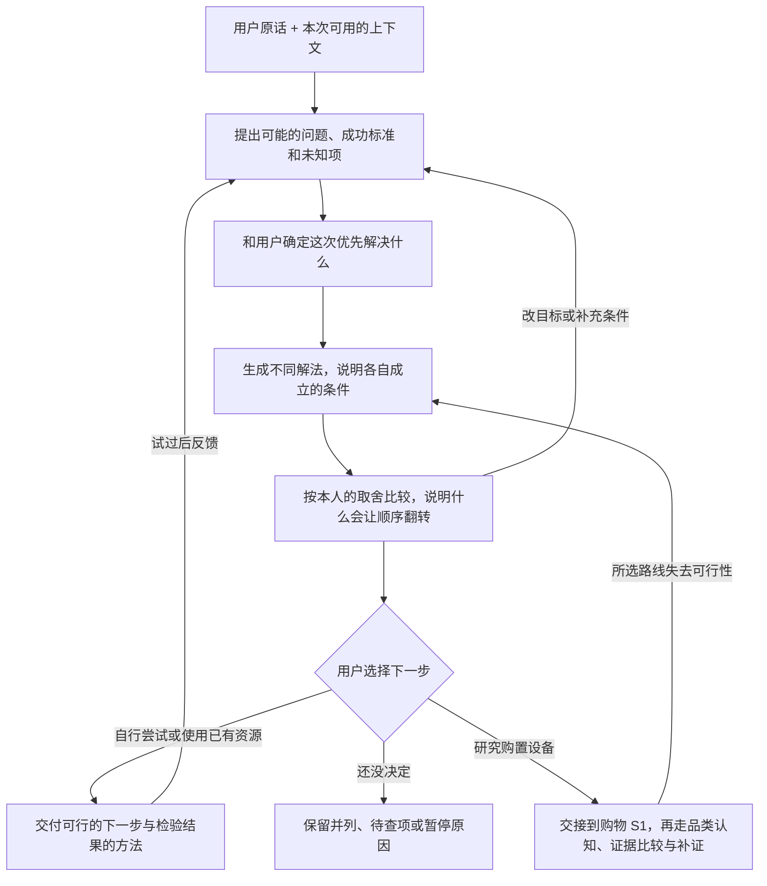

# 从用户问题到方案选择，再到购物交接

2026-11-28 · 评估者详细架构提案 · 首个验证场景为家庭文印

## 决策与依据

在购物 S1 之前设置独立的业务模块「意图理解与需求生成」。它接受一个尚无品类的问题，陪用户确定想达到的结果、找出几条解法、比较取舍，直到用户选择下一步。购物智能体是“研究购置设备”方向的接收方。首版可与现有聊天桥运行在同一应用内。逻辑上独立，使它在用户最后选择使用已有工具、自己试验或暂缓时，也能完整交付结果。

曾鸣《智能》第三章的本地整理区分三个判断。C3-02（PDF p42–44）讨论从模糊表达重建任务、约束和风险。C3-03（p44–46）讨论与用户共同定义尚未说清的问题。C3-04（p46–48）进一步问，多个需求里哪个值得优先处理，以及判断采用谁的价值标准。C3-05、06（p48–50）才进一步讨论匹配与生成供给。下面的接口和排序规则是本项目的设计推演。书中例证也应按原整理标注的推演性质理解。[本地论点整理](../../commercial-opportunity-lab/prototypes/曾鸣-智能/02_论点论据示例.md) · [第三章机制图](../../commercial-opportunity-lab/prototypes/曾鸣-智能/01_核心脉络图.md)

现有证据支持设计这个模块，但尚不足以估计实现工期或真人收益。冻结场景独立 24/24；另 8 条定向诊断 5/8，其中 3 条新用途从彩色开始问，目标确认到具体补证为 0/3。它们证明当前打印机入口会漏任务。个人价值取舍、不同解法的可行性和排序质量还需另测。[前序诊断](../handoffs/evaluator_executor/PRINTER-SCENE-ROBUSTNESS-20261127/REVIEW.md)

## 主流程与状态归属

上游拥有本次任务、候选需求、路线取舍和选择记录。下游拥有购物字段、候选事实、证据与工作单。每项事实只有一个可编辑来源，交接引用对应版本。会话中可反复修正目标，多数清晰任务只需一次交互。用户明确说“已经决定买打印机，请查是否支持自动双面”，原话已表达路线选择，可直接走购物入口，随后按原机制确认必要字段。单独提及商品、浏览某型号或点击查看方案，只表示线索或浏览。

## 怎样从上下文形成问题

| 需要理解什么 | 如何取得和使用 |
|---|---|
| 谁遇到什么困难，怎样算解决 | 先保留用户的说法，提出一句可修改的任务描述。分清实际使用者、提出问题者和承担取舍者。家长表达的期待可以记录，孩子本人的体验留待了解。 |
| 哪些上下文与这次有关 | 优先用本轮原话、用户主动提供的频次、期限、已有工具、尝试及结果。若有经授权的历史信息，仅提取会改变本次判断的片段，带上来源、时间、适用对象与范围；过期或相冲突的偏好请本人确认。初版仅使用当前会话。 |
| 有几种合理解释 | 每个假设附原话依据、相反线索、决定性未知及能区分解释的一问。系统可以问“你主要卡在交不出文件，还是每周为这事花太多时间？”接受“两者都有”“都不对”和用户自写。点击或停留不能确认动机。 |
| 如何形成新需求 | 把笼统愿望改写成用户能认可或驳回的结果。如“想买打印机”可展开为“周五前交一份清晰文件”和“以后在家独立处理同类资料”。由用户决定这次处理哪一个，可先完成前者、将后者暂存。 |
| 何时追问、何时停 | 只问答案会改变当前目标、可行方向或先后次序的问题。本人可拒答、改述、直接选方向。信息不足且用户想停，给条件式选择和最小验证动作。已有明确选择时不重复盘问。 |

每轮结果区分本人陈述、系统假设与外部可核事实。例如“我附近有打印店”可以作为用户陈述，门店今日营业、服务价格和能否及时交付仍待核实。任务摘要只保留必要信息，处理纸质病历时记录“纸张需转电子文件”即可。

## 两次优先级判断

**先排需求。** 一个模糊问题可能有几项成功标准，且有依赖关系。先找用户已明确的期限、不可牺牲的条件和必须先完成的事，再问本人最希望改善哪个结果。例如先按时交这一份，再解决长期省时。若两者同等重要则并列；涉及家长和孩子等多方取舍时，标明各自立场，意见未齐时保留分歧。

**再排解法。** 对选定目标，生成能靠不同机制达成结果的方向。先看用户已有哪些资源、可否调整做法，再考虑借用、服务、购置或暂缓。仅展示有具体行动、适用前提和区别的方向，把用户自提的方向纳入同一套比较。允许多步组合，例如先交付本周任务，再记录一个月实际频次以判断是否购置。每个方向必须写清能解决哪项需求、要付出什么、依据从哪来、哪条未知可能使它行不通。

| 判定顺序 | 输出规则 |
|---|---|
| 1. 可行性 | 已知违反本人硬条件的方向写明冲突。关键事实未知的标「待核」并给出核法。只有可行条件相同的方案才直接比较。 |
| 2. 个人取舍 | 采用本人本次认可的标准，例如交付时间、现金支出、往返次数、隐私和质量。同一维度用同口径。若某方向在所有相关且可比的维度均不差并至少一项更好，可说明它占优；其余冲突取舍由本人定优先项。 |
| 3. 缺依据时 | 若排序会因一个未知而翻转，只问这个未知或建议一个低成本验证。若本人也未形成偏好，列出“更重视 A 时先试甲，更重视 B 时先试乙”。并列是有效输出。初版采用可审计的条件规则，不设全人群统一权重。 |
| 4. 解释和纠正 | 展示“为什么此时排在前面”“哪项变化会改顺序”。用户可以改约束、调换优先项、自选靠后的方向或全部拒绝。选择表示下一步愿意探索，不能事后反写成此前推断正确。 |

模型可用于拟定问题解释、生成不同方向、提议能区分它们的问题。程序负责跟踪原话出处、区分事实和假设、核验条件冲突、绑定版本及限制路由。路线生成不读商品热度、佣金或候选库存作为个人价值依据。若模型建议缺理由、重复方向或输出非法动作，回到本人可编辑的目标、手动方向和待确认项。

## 从原话到不同选择的走读

**同一问题，两种取舍。** “每周要把两页签字纸发回单位，想买台打印机。”交付物可能是合格的电子文件。能否接受手机采集、本人已有何种设备、是否必须留在家中处理，会改变方向。假设单位接受手机采集，本人已有手机，附近门店可提供服务但价格、营业时间待核，则可以提出用手机试一页、核门店服务、研究自备扫描设备三条路。三个方向都要说明怎样验证文件达标。

- 本人确认“今天交，先用手边的，不想为这次花钱”，则先试一页并按单位要求检查可读性。若单位退回，回来核退回原因，再比较余下方向。这条路径可以在零商品检索时完成。
- 同一人后来说明“现在每周几十份，手动逐页太费时，文件不能送出，愿意研究自备设备”。门店与已确认条件冲突，手机逐页的时间负担来自本人实际体验，自备设备成为优先研究方向。是否确需自动进纸、现有型号是否支持及预算均待核。只有在本人选“研究设备”后才进入购物链。
- 仅将偏好从“少花钱”改为“少动手”，保持任务量、候选与可行性相同时，若两条路线各有已核优势，展示顺序应随本人取舍变化。若设备省时幅度还未知，则只改变先查哪项，不能把可能省时写成已占优。

**数学困难的类比。** “孩子说数学难，要不要报课？”先问最近一次具体卡在哪里、孩子怎么描述、家里试过什么，以及本次最想改善什么。理解一道题、找到反复出错的环节、减少作业冲突，可以是不同目标。若本人最想找卡点，可先回看一道典型错题或与老师核对发生在哪一步。若目标是补某个已明确的知识点，可以一起比较现有练习、校内帮助与额外辅导的时间和负担。注意力、压力、兴趣均需当事人提供线索。这个例子用于校验设计能否容纳开放问题，教育服务尚未纳入产品验证。

## 接口、修改和购物交接

| 记录 | 最小内容 | 谁能改变其效力 |
|---|---|---|
| 当前任务 | 任务标识、修订号、原话引用、使用者、期望结果、期限、已确认条件、待证解释 | 用户提交或纠正。系统草稿和本次授权上下文均标出处和适用范围。 |
| 方向比较 | 对应目标、每个方向的行动、先决条件、支持与反证、未知、用户认可的比较标准、次序或并列及翻转条件 | 依赖项改变即重算；用户可以更改标准或添加方向。 |
| 本人选择 | 方向标识、任务与比较版本、本人选择的原话或显式操作、下一步范围 | 允许改选、撤回、暂缓。过期选择需重看。 |
| 购物交接 | 上述选择引用、本人确认的目标与购物条件、来源引用、待补项、本次允许的只读研究 | 接收方校验选择仍有效、方向属于受支持品类、版本匹配。仅映射已确认且语义一致的字段。购物端回传具体缺证或路线不可行的原因。 |

**一次交接示意。** 用户选择“研究能在家批量把纸转为电子文件的设备”。上游传入目标、每周几十份和文件不能外带这两项本人陈述，并注明“是否需要一体机、自动进纸及可接受预算待确认”。若用户尚未选打印机或多功能一体机，先说明打印机研究覆盖范围并询问品类，保留专用扫描设备这一可能方向。本人明确选择打印机研究后，下游才写入对应品类与用途。“批量”本身不能写成“自动进纸必须”，也不能据此批准购买。

接收方按任务、选择与修订号识别同次交接，重复提交返回同一研究会话。改选或撤回时使旧交接及其依赖结果失效，并提示用户按新条件重算。旧工作单经原恢复流程仍可使用，作为已进入购物研究的历史记录。已有用户不必为恢复存档重新编一段动机。

**与现有代码的接点。** 在调用购物端 `_analysis` 前判断是否已有有效购物选择；桌面聊天通过同一桥呈现上游交互。已有直接购物入口继续处理明确的购物请求。购物端 `submit_message` 和 `apply_turn` 管本人条件，`choose_field` 在打印机研究内选下一问，`decision_actions.order_actions` 排已准入候选的补证行动。上游的需求与解法比较各有独立依据。已选购物方向继续消费现有品类指南、来源准入、工作单和动态核价规则。购买建议仍须给出适用条件、正反证据、来源和取得日期或有效期。实时 SKU、地区价、库存与售后由平台核实，交易另循逐项授权。[聊天桥](../shopping_decision/chat_bridge.py) · [需求写入](../shopping_decision/dialogue_flow.py) · [打印机选题](../shopping_decision/focus_guidance.py) · [补证行动排序](../shopping_decision/decision_actions.py) · [工作单](../shopping_decision/decision_worksheet.py)

## 工作量与验收

这项工作值得单列。上下文取用和纠错、生成有差异的解法、个人取舍比较、选择与交接是四份不同的实现和评估工作。最难估时的是方向覆盖与取舍质量，它们需要从用户拒绝、并列和改口的案例反复校准。当前可以切出一个贯穿四项工作的文印样稿，再用实际缺口估算开发，原执行包工时不能外推。

| 阶段 | 可交付结果 | 怎样决定是否继续 |
|---|---|---|
| 文印样稿 | 同一入口完成非购买路线、研究购置路线、方向并列和中途改口四类任务。与现有直接购物流程、上一版仅增加选题纠正的样稿对照，共用资料与候选。 | 逐轮回放可追溯每项推断，显式选择前无购物研究，非购物路线有实际下一步和成功标准；明确购买者可直达。 |
| 排序与交接验证 | 成对场景只改变一项，如本人优先标准、已知可行条件或一个无关点击。另测假设被否定、来源缺证、推广材料诱导、过期报价、冲突、重复提交、恢复与撤回、误下单。 | 改关键因素时应按预设依据翻转、并列或转为待核；只改无关行为时次序应稳定。错写硬条件、擅自路由或交易任一发生即退回。冻结已有用例与新留出分开计。 |
| 小规模理解诊断 | 建议 4–6 名新手各两项对照任务，顺序交替，允许补充系统遗漏的方向和拒绝全部选项。观察前固定成功标准。 | 记录目标复述是否准确、遗漏的可行方向、用户能否说明一条取舍及翻转条件、是否进入本人所选路线、无关追问和退出。人工复核原话与理由，不以购买率或用户顺从率衡量理解。 |

本轮为架构设计。下一项投入对应第一阶段的完整文印样稿；原诊断建议的“换当前任务”可用作交互设计与对照基线。实现、真实用户效果以及跨品类可迁移性均待验证。