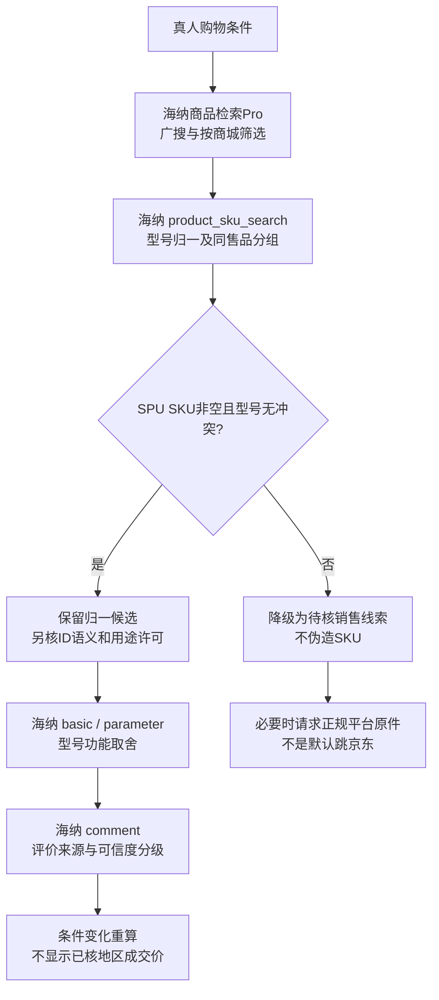

# 海纳 API + MCP 真实商品能力深入实测（执行者，2026-11-14）

> 用户本轮明确要求：不再把「海纳是否支持SKU」只留给下一执行包，执行者自己用既有Key小批量探索，尽量在海纳完成真实商品发现、SKU、参数、评价收集，减少跳京东/淘宝。**本轮是已经执行的真实调用，不是待执行建议。** API调用全部只读，未登录商城、未调用旧开放平台OAuth接口、未下单支付。

## 一、结论：已找到同一提供方的商品数据链，但尚未实现平台原生SKU闭环

1. **商品检索Pro已实测可用**：不裁剪字段能返回商城、店铺、标题、类目、部分union_spec、供应商报价/评价数及商品跳转线索；`mall_id=183`直接筛京东数据，**无需打开京东网页来得到这些初步字段**。
2. **关键突破：当前海纳 MCP 实时工具目录不是旧文档里的“只有六项”**。经真实MCP `initialize`→`tools/list`，HTTP200，返回**10个工具**，除检索外有`product_basic_search`、`product_parameter_search`、`product_comment_search`、`product_sku_search`。后四者都已在Brother/HP打印机实际调用成功，证明同源数据路径真实可用。
3. **SKU归一有阳性，但不等于平台原生SKU已核**：`product_sku_search("惠普 M232dw")` 返回非空的海纳`spu_id`、2组`sku_id`，按「型号变体」分组并关联2+5条跨平台所售商品。返回的关联商品`id`是32字符非全数字标识，**不能自称京东平台SKU号**；返回了`url`、标题、商城、卖家、销售属性、供应商`final_price`等字段。M232dw/M232dwc近形型号并存，仍需强制分组筛选。地区成交价/库存/券未知。
4. **SKU兜底真实存在**：`product_sku_search("兄弟 HL-L1238W")`给2条天猫销售线索，`spu_id`和两条`sku_id`均为空、关联商品`id`亦空；`product_sku_search("兄弟 HL-B2158W")`给3条京东线索，同样无非空SPU/SKU/关联商品ID。此时虽有`sku_list`结构，**实际不是已归一成功**，是候选线索层；不能将`sku_count=2/3`误报为2/3条有效SKU身份证据。
5. **商品知识可同源补充**：`product_basic_search`分别返回型号级基础信息；`product_parameter_search`分别返回HP 13项、Brother 16项带参数名/值/描述/置信度；`product_comment_search`分别返回3组评价观点维度、引用及来源链接字段。内容来源质量/实际型号绑定仍需审计，特别是评价文章标题含推广/SEO语气，不等于独立专业评测。
6. **真实身份主目标未过**：海纳内部分组ID≠经字段契约证明的京东/淘宝原生ID，也未取得原响应持久化/本机展示/审计许可核准。P0.9-C两个真实平台销售身份仍0/2，地区有效报价0，购物推荐批准/交易一直false。

## 二、实际调用总表与复算

全部真实业务调用**18次**，均HTTP200、业务码0，非“假数据返回”：
- 商品检索Pro REST `POST https://gw-openapi.zhidemai.com/product/v1`：**7次/成功7次**。
- 海纳MCP `https://gw-openapi.zhidemai.com/ai-mcp/streamable/mcp` 的`tools/call`：**11次/成功11次**。其中SKU 5次、商品基础信息2次、核心参数2次、评价2次；请求小样本/逐case，未自动重试。
- 另外MCP目录的`initialize`、`initialized`、`tools/list`是协议元数据动作，不是`tools/call`业务能力调用。各次业务调用建会话产生更多协议请求，未统计底层HTTP总数，也未核验Key计费账单，因此不能宣称费用0。所有操作没有调用京东/淘宝接口或跳平台详情页。
- 本轮使用本机已有且被Git忽略的`data/private/haina.env`，**读取仅在本机执行进程内，不回显/不存密钥**；全部业务原始响应仅在内存解析后丢弃，保留响应SHA-256、返回字段结构、有限脱敏候选摘要与原始回源链接的**域名/哈希**，**不保存完整推广URL**。本轮没有修改真实数据准入开关。
- 机器总索引：[haina_api_deep_probe_index_20261114.json](haina_api_deep_probe_index_20261114.json)。源脚本：[REST字段测试](haina_api_field_probe_20261114.py)、[MCP目录只读测试](haina_mcp_tool_catalog_probe_20261114.py)、[MCP业务能力单次测试](haina_mcp_tool_probe_20261114.py)、[无需联网的机器索引器](build_haina_probe_index_20261114.py)。每个成功请求有唯一脱敏JSON，无覆盖旧报告。

### 7次商品检索Pro：实际分支

| case | 查询/方法 | 响应条数 | 身份结论 |
| --- | --- | ---: | --- |
| brother_full | 「兄弟 HL-L1238W 打印机」，fields空（全字段） | 0 | **精确词零召回**，不能宣称覆盖所有机型 |
| hp_full | 「惠普 M232dw 打印机」，fields空 | 3 | 字段丰富，**独立平台ID/SKU字段0** |
| hp_ids | 同HP词，显式请求12类ID字段 | 3 | 服务端成功但这些字段**仍全部缺席** |
| brother_broad_full | 「兄弟 黑白激光打印机」，全字段 | 3 | 有标题/商城/店铺/规格等，无独立ID |
| brother_broad_ids | 同宽词、显式请求ID字段 | 3 | 同样无独立ID |
| hp_jd | HP词，加`mall_id=183` | 2 | 京东子集只读可直接取得 |
| brother_broad_jd | Brother宽词，加`mall_id=183` | 3 | 京东子集只读可直接取得 |

**实用规律**：查询过窄可能0条；应先“品类+品牌”广搜，再用型号字段过滤、MCP SKU归一与具体型号参数补充。不要认为`fields`凭空生成接口没给的`sku_id`。

### MCP在同一授权Key下实际返回什么

| 工具 | 实测提供的字段/能力 | 不能直接升级的结论 |
| --- | --- | --- |
| `product_sku_search` | `spu_id/spu_name`、`sku_count`、`sku_list[].sku_id/sku_axes/sku_products`；在售关联商品含`id`、`url`、标题、商城、店铺、类型、供应商价、部分参数与评价量 | 需要检查**ID是否为空、是不是海纳内部归一ID，以及是否有平台所售SKU的权威对应依据** |
| `product_basic_search` | 实体名、品牌、类型、描述、卖点、图片 | 型号事实不等于所选店铺的售卖SKU |
| `product_parameter_search` | `entity_parameter[]{key,value,parameter_description,confidence}`；HP 13、Brother 16 | 置信度是提供方指标，尚未与具体零售选中项逐条比对 |
| `product_comment_search` | `entity_comments[]{attribute_name,attribute_value,attribute_description,dimension,count,list_link}`；两款分别3组观点 | 来源链接不代表可信专业测评，不能自动推导耐用寿命或故障率 |

**特别注意**：官网对外宣传的SKU标准化，是提供方的产品能力主张；这次实测表明它对不同机型的身份数据差异很大，不能据宣传指标声称本项目两款商品均已通过身份核验。

## 三、怎样减少跳京东淘宝：可运行的同源路径

仅此一次实测已表明，**商品发现、型号信息、部分参数、部分SKU分组和评价来源确实可以先在海纳内部收集。** 但若目标是“真实平台所售SKU一一对应且可审计”，仍需补充以下两点，不必立即重走京东网页：

1. **产品字段定义及跨源映射**：海纳`spu_id`、归一`sku_id`、关联商品`id`的命名空间与原生京东/淘宝`item_id/SKU`关系，`sku_axes`如何表达所选配置、供应商异常/撤回与更新时刻，是否可提供来源字段锚点。
2. **授权范围**：当前个人研究用途对本机解析、用户展示、最小审计指纹及模型处理的可用条款。已有Key可调用只证明可访问能力，不能视为长期保存原件、对外提供或商业生产已授权。

### 对本仓实现的直接约束

- `product_search_pro`线索可以进入`unverified_source_leads`而非已核销售候选；调用结果暂仅作**受限实测审计**。
- `product_sku_search`须双层门禁：**海纳SKU归一阳性**与**平台所售配置ID权威绑定**严格分开；Brother的空ID不可通过，仅凭惠普的32字符内部ID也不可通过平台原生身份。
- 同一型号的`basic/parameter/comment`可作有限研究卡，保留来源与置信度，不替代实际平台SKU、2026地区当前价格/售后。
- 正式业务代码、合规真实数据持久化门禁和购买/交易开关本轮**均不改变**。不为应付验收伪造Brother正例；原P0.9-C 0/2历史事实不改写。

## 四、出处和旧平台区分

- 2026海纳官方开放站与MCP说明：`https://ai.zhidemai.com/`；本轮**本机真实MCP tools/list结果**见`haina_mcp_tool_catalog_20261114.json`，比11-09只读归档的可用工具信息更完整。
- 值得买**旧版**开放平台在2021年的公开文档确实有「SPU下SKU查询API」「销售属性查询API」，分别支持`SpuID/SkuID`与SKU销售属性列表。但该旧平台要求`App_Key/Access_Token`及旧签名，**不是当前海纳`x-api-key`接口，不可假定可直接使用**，本轮没有调用。
- 商品检索Pro 2026归档请求文档：`reports/supplier_haina_product_docs_20261109.json`；旧2026-11-10惠普5条单次实验仍保留，不受本次新请求覆盖。

## 五、执行者本轮交付与限制

**已完成**：REST全字段/ID字段/商城过滤7次；MCP工具目录实时10项；SKU真实5次、基础2、参数2、评价2；18份脱敏JSON、执行脚本及机器索引；没有京东淘宝跳转/登录，也没有API Key泄露。

**未完成**：供应商条款与平台原生SKU映射核实、原始数据合法持久化、两个真实所售SKU独立验证、用户地区成交价、正式业务接线、外部独立验收。费用/配额真实账单未查，不宣称免费无成本。

**下一实践方向**：把海纳MCP作为上游首选收集层；评估者结合真实输出确定最小`normalized_sku`契约与许可范围。若许可不足则仍安全降级线索，不把“从京东页面验证”当默认必须动作。无需重新申请Key或继续盲目搜索静态商品库。

**本轮操作权限**：用户在对话中直接允许重复探索海纳API。没有新增付费、商业API授信、用户账户自动化、商城验证码绕过、下单、外发或Git提交推送。
